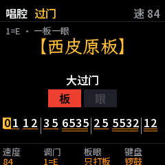

# LUOGU

**Peking opera percussion and accompaniment in your M-VAVE FM-1.** LUOGU plays the 锣鼓经 (luogu jing, the
percussion patterns of 京剧) and the 京胡 (jinghu) interludes of the 唱腔 (the sung modes), so you can learn the
percussion by playing along, or sing an aria with its own band. Everything runs on the FM-1's chip. By Reytian.

**[中文说明](#中文说明)** · [Manual (中文)](app/docs/MANUAL.md)

- **64 锣鼓经 patterns**, from 急急风 and 四击头 to 夺头, 凤点头, 撕边 and 水底鱼, each with its 起, its 中 that repeats
  until you cut it, and its 收. The 字谱 (the syllables: 仓 才 七 台 ...) lights up as it sounds, with 板 (×) and 眼 (○)
  marked.
- **Play along and get scored.** Pick the instrument you play (鼓板, 大锣, 铙钹, 小锣 or 堂鼓): LUOGU leaves its
  strokes out, and you play them on the keys or a MIDI pad. Each stroke is judged 准 (on time), 早 (early) or 晚
  (late); missed and extra strokes count against you.
- **Sing with a band.** 18 板式 (西皮原板, 二黄原板, 慢板, 快三眼, 二六, 流水, 快板, 摇板, 导板, 散板, 南梆子, 四平调,
  反二黄): the 锣鼓 leads in, the 京胡 plays the 大过门 (its 简谱 shown note by note), then the 板 keeps time while
  you sing. Press SEQ at the end of a line for the 小过门; if you play the line's last note (its 落音) on the keys
  first, LUOGU picks the 过门 that follows that note. PLAY ends it with the closing 锣鼓.
- **Whole arias (唱段).** Five arias with their 京胡 托腔, from the Jingju Music Scores Collection: 苏三离了洪洞县,
  我本是卧龙岗散淡的人, 一轮明月照窗前, 当日里好风光忽觉转变, 深宫无处不飞花. The 京胡 plays you through the whole
  aria and the lyrics light up syllable by syllable (non-commercial use only: see the licence below).
- **京胡, 京二胡 and 月琴.** The 京二胡 doubles the 京胡 an octave down and the 月琴 plucks the main notes; either can be
  switched off. The 调门 (key) is set per 声腔: 西皮, 二黄, 反二黄, 四平调, 南梆子.
- **The keys are the band.** The keys play the strokes, each player's laid out the way their hands go (the 鼓师's 板
  on the left, his sticks on the right; a gong's damping hand left of its mallet), and whole syllables like 仓 on the
  top keys; SEL shows the map. Or they play a 京胡, 京二胡 or 月琴 in the 调门: the white keys from C are 1 2 3 4 5 6
  7 in 简谱.
- **跟练 (follow-along practice).** The music follows you through a 锣鼓经: it waits at each syllable until you
  strike its key, and moves straight on when you strike the next one early; the 字谱 turns from dark to yellow as
  you go, and in a 板式 the 京胡's 过门 starts only once you have played the lead-in right.

**Status: [1.0.1](https://github.com/Reytian/fm1-luogu/releases/tag/v1.0.1) is the current release** (an image of
576 KB). It runs on an FM-1; most of the testing has been in fm1-base's host simulator, which
runs the same code. The audio load is estimated from
instruction counts at no more than 35 % of a core in its busiest 2.9 ms block, under the 60 % budget; it hasn't been
measured on the chip.

## The music

The patterns and the 过门 are traditional. LUOGU's versions were collected from printed and teaching sources and
cross-checked: the 中国戏曲研究院's percussion notation, 穆文义's percussion textbook (2007), 《京剧胡琴入门》 (1955),
刘碧清's 《京剧常用过门》 (1998), and the books transcribed in the Jingju Music Scores Collection (曹宝荣 2010, 刘吉典
1981). Where sources disagree, the data file says so. Of the 64 patterns, 39 are confirmed by two or more
independent notations (✅ in `data/luogu.txt`), 18 rest on one source or have details left open (⚠️), and 7 are
uncertain (❓). Of the 36 过门, 22 are graded high or medium-high (`data/guomen.txt`, with each one's sources). The
tempos are estimates, except five measured from recordings. Local opera forms (豫剧, 越剧, 黄梅戏, 评剧, 川剧 ...) are not covered: their percussion and
fiddles differ from 京剧's.

The drum plays the 鼓师's part that a 锣鼓经's text leaves out: it strikes with the gongs and fills the eighths at the
endings, as the multi-instrument scores in 穆文义's textbook show (the screen still shows the traditional syllables).

The 单皮鼓, the 板, the 小锣 and the 铙钹 are real strokes, recorded by a 京剧 percussionist (the Beijing Opera
Percussion Instrument dataset, CC BY 4.0). The 大锣 is synthesized as a 虎音锣, the 大锣 of 京剧, measured from the
CTIS database: each partial's frequency, level and decay, and a pitch that sinks some 7 semitones after a hard stroke,
less after a soft one, as on 京剧 recordings. The 京胡's and 京二胡's bodies are filters fitted to recordings of real
playing.

## Controls

| Control | What it does |
| --- | --- |
| HOME | The 锣鼓 page (a pattern) or the 唱腔 page (a 板式 to sing to) |
| PRESET | The group: on the 锣鼓 page the next kind of pattern; on the 唱腔 page the 板式 or the 唱段 |
| ALGO | The pattern, or the 板式 or 唱段 within its group (SELECT picks nothing: it says which knob does) |
| PLAY | Start; again: the 收 (the ending); held: stop now |
| SEQ | Singing: the 小过门 at the next 板 |
| REC | Practice: the pattern from its start, your instrument scored (in 跟练: right and wrong strokes counted) |
| FX | 跟练: the music waits at each syllable till you strike its key, and moves on at once to the next one struck early; the 字谱 turning yellow as you go; a 板式's 过门 starts once you have played its lead-in. Stopped, the first syllable's key starts it |
| SEL | The keys' map: each key's syllable, coloured by player, lit as you press it |
| K1 · K2 · K3 · K4 | Tempo · 乐器 (your instrument; 全部: all of them) or 调门 (the key) · 跟练 or 板眼 (the 板 alone, or the 眼 too) · what the keys play |
| ARP | Loop the pattern |
| EDIT | What the pattern is for |
| GLO | The mix: 武场 (鼓板, 大锣, 铙钹, 小锣), 文场 (京胡, 京二胡, 月琴, keys), reverb |
| OCT− · OCT+ | The keys an octave down or up |
| SAVE | Keep the settings |

A MIDI keyboard or pad works over USB: its notes F3 to G5 play like the FM-1's keys.

## Build and test

LUOGU is an fm1-base firmware: fm1-base is a git submodule in `base/`.

    git clone --recursive https://github.com/Reytian/fm1-luogu
    ./build.sh                    # app/build/luogu.fwsc (the JieLi toolchain; in Docker on macOS)
    ./build.sh --host             # the host simulator: app/build/host/luogu_host
    tests/run_tests.sh            # every test (needs only a C compiler and Python with Pillow)

The build needs a Python 3 with Pillow (`PYTHON=...` picks one), the JieLi toolchain and JieLi's AC79 SDK. For
details, see fm1-base's README. To install a build: `python3 base/tools/fm1_install.py app/build/luogu.fwsc`. To
install the release, download `luogu-1.0.1.fwsc` from [Releases](https://github.com/Reytian/fm1-luogu/releases) and
run `python3 base/tools/fm1_install.py luogu-1.0.1.fwsc` in a clone (the installer needs mido with python-rtmidi).
Installing is at your own risk; M-VAVE's own firmware can be put back the same way.

| Path | What |
| --- | --- |
| `app/app.c`, `app/app.h` | The screens, the controls, the settings |
| `app/zh.c`, `app/dsp/zh_font.h` | The Chinese text: bitmap fonts of the characters the screens use (written by `tools/zh_font.py`) |
| `app/dsp/lg.c`, `lg.h` | The engine: the transport, the 板式's flow, the 过门's notes and ornaments, the practice's judging, the mix |
| `app/dsp/perc.c`, `perc_tab.h` | The percussion: recorded strokes played as voices; the 大锣's modes with their sinking glide, noise bands, the contact (the tables written by `tools/perc_fit.py`) |
| `app/dsp/samp_tab.h` | The recorded strokes (CC BY 4.0), written by `tools/samples.py` from the BOPI dataset |
| `tools/tq_data.py` | 唱段: five arias' 京胡 parts and lyrics from the Jingju Music Scores Collection, into `app/dsp/tq_data.h` (CC BY-NC-ND 4.0: see below) |
| `app/dsp/hu.c`, `hu_tab.h` | The 京胡 and 京二胡 (bowed: a sawtooth through a fitted body) and the 月琴 (plucked strings) |
| `app/dsp/lg_data.h` | The patterns, 过门 and 板式, written by `tools/lg_data.py` from `data/luogu.txt` and `data/guomen.txt` |
| `data/` | The music, in a plain text notation described at the top of each file |
| `tools/` | The data compiler, the fonts, the logo, the recorded strokes, the percussion's and strings' fitting from recordings, a rough 京胡 transcriber |
| `tests/host/`, `app/tests/` | The engine offline (a WAV), its audio load, single strokes and notes; simulator scenarios |

## Licence and credits

The 唱段's scores are the Jingju Music Scores Collection's, set from printed books that are their editors'.
`app/dsp/tq_data.h` holds them converted to a form to play from, their notes unchanged, so it is under their licence,
**CC BY-NC-ND 4.0** (`LICENSES/`), not the MPL: LUOGU's firmware with the 唱段 in it may be shared, but not sold or
used commercially. A 彩蛋 carries two sung words from a recording of 郭德纲 and 于谦's 《黄鹤楼》 (德云社,
`app/dsp/guo_snd.h`): they belong to their owners and are not under LUOGU's licence.

LUOGU is by Reytian, under the MPL-2.0 (see [LICENSE](LICENSE)). Built on
[fm1-base](https://github.com/charlesvestal/fm1-base) by Charles Vestal and
[felucca-bsp](https://github.com/hugelton/felucca-bsp) by Leo Kuroshita, Hügelton Instruments. The screen's Chinese
is drawn from Noto Sans SC and LXGW WenKai, the logo's 锣鼓 from Fusion Pixel Font (all SIL OFL 1.1, `LICENSES/`).
The percussion's recorded strokes are from the Beijing Opera Percussion Instrument dataset (CC BY 4.0: they are
under that licence in LUOGU too); the 大锣 was measured from the CTIS database (numbers only), the 京胡 from the Jingju
a Cappella Recordings Collection (CC BY 4.0). See [CREDITS.md](CREDITS.md).

M-VAVE and FM-1 are trademarks of their owners. LUOGU is not affiliated with M-VAVE.

## 中文说明

**LUOGU：FM-1 上的京剧锣鼓和胡琴。** 它能打 64 套锣鼓经，能拉 18 种板式的京胡过门，学锣鼓可以跟着打，唱京剧可以
自拉自唱。全部在 FM-1 自己的芯片上运行。

- **锣鼓经**：急急风、四击头、夺头、凤点头、撕边、水底鱼等 64 套，每套分起、中（反复，直到你收）、收。字谱随着
  声音逐字点亮，板（×）眼（○）标出。
- **跟打练习**：选一样你打的乐器（鼓板、大锣、铙钹、小锣、堂鼓），LUOGU 就不打这一样，由你在键盘或 MIDI 打击垫
  上打。每一下判准、早、晚，漏打和多打都记下，打完给出得分。
- **自拉自唱**：西皮原板、二黄原板、慢板、快三眼、二六、流水、快板、摇板、导板、散板、南梆子、四平调、反二黄共
  18 种板式。锣鼓开唱，京胡拉大过门（屏幕上逐音显示简谱），然后板给你打着拍子，你来唱。一句唱完按 SEQ 起小过门；
  按之前先在键盘上弹出这句的落音，LUOGU 就接对应落音的过门。按 PLAY 收住，锣鼓收尾。
- **唱段**：五段完整的唱段，京胡托腔一路托着你唱到底，唱词逐字点亮：苏三离了洪洞县、我本是卧龙岗散淡的人、
  一轮明月照窗前、当日里好风光忽觉转变、深宫无处不飞花。谱子来自 Jingju Music Scores Collection（CC BY-NC-ND
  4.0），只限非商业使用。
- **京胡、京二胡、月琴**：京二胡低八度托着京胡，月琴弹主干音，都可以关掉。调门按声腔分别设：西皮、二黄、反二黄、
  四平调、南梆子。
- **键盘就是乐队**：键盘可以当锣鼓打，每位乐手的键按他真实的左右手排（鼓师左手板、右手楗子；锣是左手按、右手敲），
  上面几个键是整字，如仓；按 SEL 看键位图。也可以当京胡、京二胡、月琴拉，按调门走：从 C 起的白键是简谱的
  1 2 3 4 5 6 7。
- **跟练**（FX）：音乐跟着你走。锣鼓经的每个字等你打对了才往下走，打对一个字变黄一个；你提前打对下一个字，音乐马上
  跳过去接着走。停着的时候打第一个字就开始。唱腔里开唱的锣鼓经打对了，京胡才进来拉过门。

**现状：已发布 [1.0.1](https://github.com/Reytian/fm1-luogu/releases/tag/v1.0.1)**（固件 576 KB）。已经在 FM-1 实机上跑；大部分测试在 fm1-base 的模拟器里完成，和实机跑的是同一份代码。音频负载按指令数
估算，最忙的 2.9 毫秒音频块不超过一个核的 35%（预算 60%），还没在芯片上实测。

**安装**：从 [Releases](https://github.com/Reytian/fm1-luogu/releases) 下载 `luogu-1.0.1.fwsc`，USB 连上 FM-1，在本仓库的
克隆里运行 `python3 base/tools/fm1_install.py luogu-1.0.1.fwsc`（要先装 mido 和 python-rtmidi）。风险自负；M-VAVE
原厂固件也能用同样的方法刷回去。

锣鼓经和过门都是传统的，取自打击乐简谱、教材和过门谱，并且相互核对过（来源见 [CREDITS.md](CREDITS.md)）。64 套
锣鼓经里 39 套有两种以上独立记谱互相印证（`data/luogu.txt` 里标 ✅），18 套只有一个来源或细节未定（⚠️），7 套存疑
（❓）；36 段过门里 22 段可靠程度为高或中高（`data/guomen.txt`，每段注明来源）。速度除了 5 套是从录音量出来的，其余
都是估计的。地方戏（豫剧、越剧、黄梅戏、评剧、川剧
等）没有收：它们的锣鼓和胡琴跟京剧不一样。鼓按穆文义教材里的总谱补上了鼓师的鼓点：随锣击鼓，收头处在长音里加
八分音符（屏幕上仍显示传统字谱）。单皮鼓、板、小锣、铙钹用的是京剧打击乐演奏员的真实录音（Beijing Opera
Percussion Instrument 数据集，CC BY 4.0）。大锣是合成的虎音锣，按 CTIS 数据库的录音逐个分音测量建模，重击后音高往下
沉约 7 个半音，轻击沉得少，和京剧录音里一样。京胡、京二胡的琴筒共鸣按真实演奏录音拟合。

详细用法见[说明书](app/docs/MANUAL.md)。
