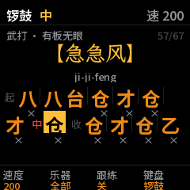
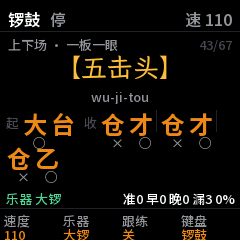
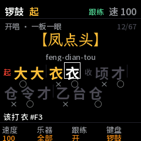
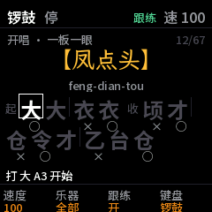
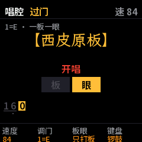
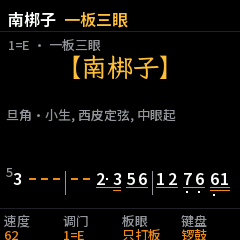
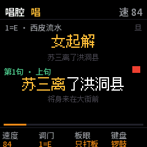
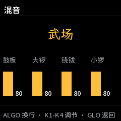
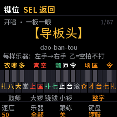

# LUOGU 说明书

LUOGU 是 M-VAVE FM-1 上的一个固件：一台能打京剧锣鼓、能拉京胡过门的小乐队。学锣鼓经，可以听它打、跟着它打、让它给你
打分；学唱，可以让它开唱、拉过门、打着板陪你唱。

> 现状：还没发布，还没在 FM-1 实机上跑过。下面写的都已在 fm1-base 的模拟器里验证（模拟器和实机跑同一份代码）。

开机时先是 LUOGU 的标志：一面锣，锣上写着“锣鼓”。锣面上一圈圈的亮光往外荡开，像刚被敲过，大约一秒后进入上次的页面；
按任何键、按钮或转旋钮都会马上跳过。

## 一、两个页面

按 **HOME** 在两个页面间切换：**锣鼓**页练一套锣鼓经，**唱腔**页选一种板式来唱。按 **GLO** 进混音页，再按一次回来。

### 锣鼓页

- **选套路**：转 **ALGO**。转 **PRESET** 跳到下一类的第一套。分类：开唱、收腔、念白散垫、上下场、情绪、武打、板眼。
  **SELECT** 不选东西，转它屏幕上会提示该用哪个旋钮。
- **打**：按 **PLAY** 开始。先打“起”，再反复打“中”，直到你按 **PLAY** 收：打完“收”就停。按住 **PLAY** 不放，马上
  停。按 **ARP** 开“循环”：整套打完从头再来。
- **屏幕**：第一行是分类和板式（一板一眼、一板三眼、有板无眼、散板、变换拍子），右边是第几套；中间是名字和拼音；下面
  是字谱，分“起”“中”“收”三段，正在响的字亮起，打过的字变暗。字下面的 × 是板，○ 是眼。“中”反复时后面显示 ×2、×3。
  字谱长的会自动往上翻，右下角 ▼ 表示下面还有。
- **用途**：按 **EDIT** 看这套锣鼓经用在什么场合、配什么身段，再按一次回到字谱。
- **速度**：转 **K1**。每套都有自己的常用速度，选套路时自动换上。

### 乐器：你打哪一样

转 **K2** 选“乐器”：全部、鼓板、大锣、铙钹、小锣、堂鼓。鼓板指单皮鼓和板（鼓师一个人打这两样）。

- 选了一样（比如小锣）：乐队不打这一样，留给你在键盘（见下面的键位表）或 MIDI 打击垫上打，别的乐器照常一起响。
- 选“全部”：平时是整个乐队都打、你听着；跟练的时候，每个字都由你来打。

### 跟打（练习：给节奏打分）

1. 转 **K2** 选你打的乐器。
2. 按 **REC**：从头打这一套，乐队照常往下走，你选的那一样由你来打。
3. 每一下都判：前后 45 毫秒以内算**准**，再偏 150 毫秒以内算**早**或**晚**，该打没打算**漏**，不该打的算**多**。
   屏幕底下实时显示，打完给出得分：准算一分，早和晚算半分，除以应打的加上多打的。

乐器是“全部”时按 REC，屏幕会提示先选一样乐器。平时（不按 REC）选了乐器也一样不打那一样，只是不计分，适合先熟悉。

### 跟练（打对了才往下走）

按 **FX**（锣鼓页也可以转 **K3**）开关跟练，开着时屏幕右上角显示“跟练”。跟练时音乐跟着你走：

- 字谱上的字先是暗的，下一个该打的字框起来，底下写着“该打 大 A3”：该打的字和一个能打它的键。打对了，字变黄。
- **你慢，它等**：音乐走到框着的字就停下，等你打对了再往下走。
- **你快，它跟**：音乐还没走到，你就打对了下一个字，音乐马上跳到那个字接着走。一段的字打完、你先打了下一段的第一个字，
  也算。
- **打错了不算**：框着的字不变，屏幕提示“不对”和该打什么。
- **乙不用打**：字谱里的“乙”是空拍，框不会停在它上面，直接跳到它后面那个字。
- **停着也能开始**：开着跟练、还没按 PLAY 的时候，第一个字框着，底下写着“打 大 A3 开始”，直接打这个键就开始（按
  PLAY 也行）。

- 什么键算对：这个字自己的键。上面一排的整字键（仓、顷、才、匡、台、七、令、扎），或者只有一样乐器的字对应那样乐器的键（比如
  “大”是 A3，“台”是 A4 或 E5，“衣”是 #F3）。“匡”也可以打大锣的匡键 D4。
- 乐器（K2）选了一样：只在有这样乐器的字上等你，要打这样乐器的键，打法要对（比如小锣：台是开击 A4，令是轻击 #A4），
  别的乐器照常一起响。
- 唱腔页也一样：西皮流水、西皮原板等，开唱的锣鼓经要你一个字一个字打对，全打完京胡才进来拉过门；唱的时候的板和过门
  不等你。按 PLAY 收的时候，收尾的锣鼓经也要你来打。停着的时候屏幕上是开唱锣鼓的第一行，打第一个字就开始。
  唱腔页底栏没有跟练这一项，屏幕右下角写着“FX 关跟练”：按 FX 就关掉（再按一次打开）。开唱锣鼓打到一半关掉，
  锣鼓就自己接着打下去。
- 按 **REC** 从头开始，打完显示“对几下 · 错几下”。
- 想看键在哪：按 **SEL** 看键位图（见下面“键盘”一节）。

### 唱腔页

- **选板式**：转 **ALGO**，只在板式里转，到头了从头再来，不会转到唱段里去。停着的时候，屏幕上写着这个板式的用法（谁
  唱、眼起还是板起、上下句落什么音），下面是大过门开头几小节的简谱。
- **开始**：按 **PLAY**。顺序是：开唱锣鼓（屏幕显示它的字谱）→ 大过门（屏幕逐音显示京胡的简谱，正在拉的音亮起）→
  屏幕出现红色的 **开唱**，就是该你张嘴的地方 → 你唱，屏幕显示“唱上句”或“唱下句”，板眼格子跟着拍子亮，板打在每个
  板上。
- **小过门**：一句唱完，按 **SEQ**。下一个板起小过门，拉完接着唱下一句。
  - **落音**：过门要接得上你最后一个字的音。先在键盘上弹一下这句的落音（K4 选京胡、京二胡或月琴），或者在 MIDI 键盘上
    弹，4 秒内按 SEQ，LUOGU 就接“落 2”“落 1”这样对应的过门，屏幕显示“过门 落2”。没弹，就按上句、下句交替接默认的过门。
- **收**：按 **PLAY**。拉完收尾的过门，锣鼓收住（收头、住头等，看板式）。按住 **PLAY** 马上停。
- **调门**：转 **K2**。每个声腔（西皮、二黄、反二黄、四平调、南梆子）分别记住自己的调门，默认西皮、二黄、四平调、南梆子
  1=E，反二黄 1=B（男声票友的常用调门；女声二黄常用 D，四平调常用 C）。
- **板眼**：转 **K3**，“只打板”或“板和眼”：唱的时候是只在板上打一下，还是眼上也打。
- **散板类**：导板、散板没有固定拍子，屏幕显示“散板 · 自由节奏”，不显示板眼格子。导板只唱一句：唱完按 PLAY，锣鼓
  收住。散板每句唱完按 SEQ，先一锣，再拉过门。摇板是“紧拉慢唱”：京胡一直按板拉，你随意唱，唱完按 PLAY 收。

#### 简谱怎么读

屏幕上的简谱是京胡自己的谱：西皮的内弦是 6̣（低音 6），二黄的内弦是 5̣。

| 记号 | 意思 |
| --- | --- |
| 1 2 3 4 5 6 7 | 唱名 do re mi fa sol la si；0 是休止 |
| 数字上面一点 / 下面一点 | 高八度 / 低八度 |
| 数字下面一条线 / 两条线 / 三条线 | 八分音符 / 十六分音符 / 三十二分音符；同一拍里的线连在一起 |
| 数字后面一个小点 | 附点：长一半 |
| 数字后面一条短横 | 多延长一拍 |
| 左上角的小数字 | 倚音：先很快拉一下这个音 |
| 竖线 | 小节线，后面第一个音落在板上 |

### 唱段（京胡托着唱）

唱腔页除了板式，还有几段完整的唱段：京胡从过门开始，一路托着你唱到底，唱词一句一句显示。

> 唱段的谱子来自 Jingju Music Scores Collection，按它的许可（CC BY-NC-ND 4.0）只限非商业使用：带唱段的固件可以
> 转给别人，但不能卖，也不能用于商业用途。

- **选唱段**：在唱腔页转 **PRESET**，在“板式”和“唱段”两组之间切换；再转 **ALGO** 在这一组里选哪一段。现在有五段：

  | 唱段 | 戏 | 板式 |
  | --- | --- | --- |
  | 苏三离了洪洞县 | 女起解 | 西皮流水 |
  | 我本是卧龙岗散淡的人 | 空城计 | 西皮快三眼转原板 |
  | 一轮明月照窗前 | 文昭关 | 二黄慢板 |
  | 当日里好风光忽觉转变 | 锁麟囊 | 西皮原板转流水 |
  | 深宫无处不飞花 | 龙凤呈祥 | 西皮原板 |

- **开始**：按 **PLAY**。先打这段第一种板式的开唱锣鼓（跟练开着就由你打），然后京胡拉过门，到第一个字屏幕显示红色的
  **开唱**，京胡接着托腔，直到唱完，锣鼓收住。
- **屏幕**：现在这句唱词是大字，唱到哪个字，哪个字以前变黄；下一句是小字；左上写着第几句、上句还是下句（句与句之间
  写“过门”）；右上的小方块是板眼，红的是板；最底下一条是这段唱到哪儿了。括号里的衬字（如“呐”“呀”）颜色淡一些。
- **速度**：转 **K1**。各段的速度一起变（转原板、转流水时会快一些）。苏三离了洪洞县和一轮明月照窗前的速度是按真实录音
  量的，另外三段是估的，不合适就转 K1。
- **调门**：转 **K2**，按这段的声腔（西皮或二黄）记住调门。**板眼**：转 **K3**。
- **收**：唱的中间按 **PLAY**，到下一个板收住（锣鼓收）。按住 **PLAY** 马上停。

这些唱段的京胡谱来自 Jingju Music Scores Collection（见 CREDITS.md），只供自己学着用，不能分享；公开发布的 LUOGU
不带唱段。要自己生成：下载这个谱集，运行 `tools/tq_data.py`。

### 混音页

按 **GLO** 进来。转 **ALGO** 换一行，**K1–K4** 调这一行的四个：

| 行 | K1 | K2 | K3 | K4 |
| --- | --- | --- | --- | --- |
| 武场 | 鼓板 | 大锣 | 铙钹 | 小锣 |
| 文场 | 京胡 | 京二胡 | 月琴 | 键盘 |
| 其他 | 混响 | 键盘弹什么 | 京二胡开关 | 月琴开关 |

堂鼓跟着鼓板的音量走。默认音量是这样配的：锣鼓开唱和京胡过门差不多一样响，京二胡比京胡轻一点，月琴再轻一点；
锣鼓叠着打或者你在上面加打太响时，输出会自动压一下，不会破音。

## 二、键盘

**K4** 选键盘弹什么：锣鼓、京胡、京二胡、月琴。**OCT−**、**OCT+** 移八度。FM-1 的键盘有力度，MIDI 键盘也一样。

### 当锣鼓打

按 **SEL** 看键位图（再按一次回去）：每个键上写着它打的字，颜色分乐器，按下去的键会亮。键盘切到京胡等时，图上显示简谱。

下面四组键各管一位乐手，从左到右：**鼓师、大锣、铙钹、小锣**（和混音页的顺序一样）。每一位乐手的键都按他真实的
左右手排：**左边是左手的事，右边是右手的事。**

- **鼓师**：左手拿板，右手拿鼓楗子。所以从左到右是 扎、衣（板）→ 八、嘟（两只楗子）→ 大、多（右手单楗）。
- **大锣、小锣**：左手提着锣，用手按住止音；右手拿锣槌（小锣是锣板子）敲。所以从左到右是 止（左手按）→ 宫 / 匝（敲的
  同时按住，闷击）→ 匡 / 台（右手开击）→ 空 / 令（右手轻击）。
- **铙钹**：两手各拿一片。从左到右是 扑（合上压住）→ 七（开击）→ 颤（滚）。铙钹没有单独的轻击键：“顷”里铙钹那一下
  轻击，就是轻轻打七（键盘分轻重）。
- 最上面一排一键打一个整字（几样乐器一起响）。

打“嘟”“颤”“堂鼓滚”的键按住就一直滚，松开停。

字谱里的 **乙** 是空拍：这一拍谁也不打，所以没有它的键（键位图上写着“乙=空拍不打”）。“-” 是前一下的延长，也不用打。
跟练时框会直接跳过它们，它们也不会变黄。

| 键 | 字 | 乐器、打法 | 键 | 字 | 乐器、打法 |
| --- | --- | --- | --- | --- | --- |
| F3 | 扎 | 板，重击（左手） | G4 | 止 | 小锣，止音（左手） |
| F#3 | 衣 | 板，轻击（左手） | G#4 | 匝 | 小锣，闷击 |
| G3 | 八 | 单皮鼓，双楗 | A4 | 台 | 小锣，开击（右手） |
| G#3 | 嘟 | 单皮鼓，滚 | A#4 | 令 | 小锣，轻击（右手） |
| A3 | 大 | 单皮鼓，右楗重击 | B4 | 滚 | 堂鼓，滚 |
| A#3 | 多 | 单皮鼓，右楗轻击 | C5 | 仓 | 大锣 + 铙钹 + 小锣 |
| B3 | 堂 | 堂鼓 | C#5 | 顷 | 大锣轻 + 铙钹轻 |
| C4 | 止 | 大锣，止音（左手） | D5 | 才 | 铙钹 + 小锣 |
| C#4 | 宫 | 大锣，闷击 | D#5 | 匡 | 大锣 + 铙钹 + 小锣 |
| D4 | 匡 | 大锣，开击（右手） | E5 | 台 | 小锣 |
| D#4 | 空 | 大锣，轻击（右手） | F5 | 七 | 铙钹 |
| E4 | 扑 | 铙钹，合上压住 | F#5 | 令 | 小锣轻 |
| F4 | 七 | 铙钹，开击 | G5 | 扎 | 板 |
| F#4 | 颤 | 铙钹，滚 | | | |

MIDI 键盘或打击垫从 F3 到 G5 和上表一样，跟练和跟打也认 MIDI。

### 当京胡、京二胡、月琴拉

按调门走：从 C 起的白键是简谱的 1 2 3 4 5 6 7，黑键是升降音。C4 是京胡中音区的 1（屏幕大过门里不带点的 1），京二胡和
月琴低八度。在唱腔页，弹的时候屏幕右上角（板式名上面）显示弹的是几，比如“京胡 3”。可以跟着过门一起拉，也可以唱的时候
自己托腔；
最后弹的那个音就是按 SEQ 时告诉 LUOGU 的落音。

## 三、保存

按 **SAVE** 保存：当前页面、选的套路和板式、速度、各声腔的调门、混音、乐器、键盘、八度、循环、板眼、跟练。有改动没保存时
SAVE 灯亮。

## 四、锣鼓经和过门从哪来，靠不靠得住

都是传统的东西，LUOGU 的版本是从这些来源整理、相互核对的：中国戏曲研究院的打击乐简谱和字谱表，穆文义的打击乐教材
（2007），《京剧胡琴入门》（1955），刘碧清《京剧常用过门》（1998 手抄本），以及 Jingju Music Scores Collection 收录的
曹宝荣《京剧唱腔板式解读》（2010）、刘吉典《京剧音乐概论》（1981）等书的唱腔谱。

- **锣鼓经**：64 套里 39 套有两种以上独立记谱互相印证（✅），18 套只有一个来源或有细节没定（⚠️），7 套存疑（❓）。
  每一套的来源和可靠程度都写在 `data/luogu.txt` 里。望家乡是不是紧锤、九锤半是不是双飞燕，来源说法不一。
- **过门**：36 段，可靠程度分高、中高、中、中低，每段写明出自哪本书、哪出戏（`data/guomen.txt`）。反二黄原板的过门
  还要核对。
- **速度**：导板头、慢长锤、夺头、小锣夺头、闪锤五套是从录音里量的，其余是按资料里的快慢关系估的，请按自己的习惯用
  K1 调。
- **字谱的字**：空（大锣轻击还是闷击）、宫（大锣闷击，只有一个来源）等，各家叫法不完全一样，取的是多数来源的说法。
- **地方戏**：没有收。豫剧、越剧、黄梅戏、评剧、川剧、秦腔等的锣鼓和主奏乐器都和京剧不同，没有找到足够可靠的资料。

## 五、声音是怎么做的

单皮鼓、板、小锣、铙钹是真实录音：京剧打击乐演奏员一下一下打的（Beijing Opera Percussion Instrument 数据集，
CC BY 4.0），每样有开击、轻击、闷击，常打的开击各录两下轮流用，不会每下都一模一样；打得轻声音也暗一些。大锣是
合成的虎音锣（京剧用的大锣），按 CTIS 数据库的录音逐个分音测：重击后音高往下沉约 7 个半音，一秒内沉一半，越响沉得
越多，和京剧录音里的大锣一样。堂鼓是凭耳朵调的合成音。

锣鼓经的字谱只写锣钹的字，鼓师的鼓点是按惯例打的。LUOGU 按穆文义教材里五套锣鼓经的总谱补上了鼓点：鼓随锣钹的每一
击打（循环的"中"里只打在拍上），收头处锣钹的长音里加八分音符的鼓，最后一小节只随大锣。这些鼓点不显示在字谱里，
跟打练习时也不算你该打的。京胡、京二胡是弓弦（锯齿波加弓毛的噪声）过一个琴筒共鸣滤波器，滤波器按 Jingju a Cappella Recordings
Collection 里的京胡伴奏录音和 CTIS 数据库里的二胡录音拟合；月琴是拨弦模型，余音长短按 CTIS 月琴录音量的。各乐器的
响度按测得的响度（K 计权）配平。

## 六、已知的问题

- 还没在 FM-1 实机上跑过；音频负载是按指令数估的（最忙的时候约一个核的 52%，预算 60%）。
- 堂鼓的音色是凭耳朵调的，没有对照录音。
- 过门里的滑音、颤音、倚音是按谱上的记号做的，没有琴师的个人风格。
- 唱的时候京胡不跟腔（LUOGU 不知道你唱什么）：唱段中间只有板眼，你可以自己在键盘上托腔。
